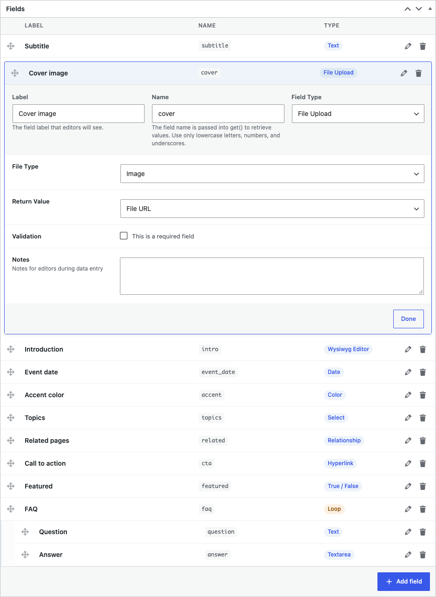
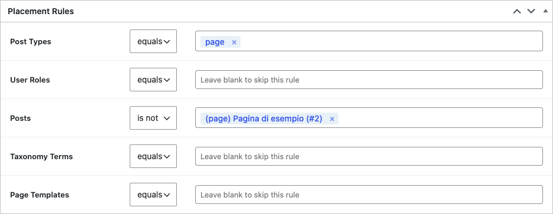
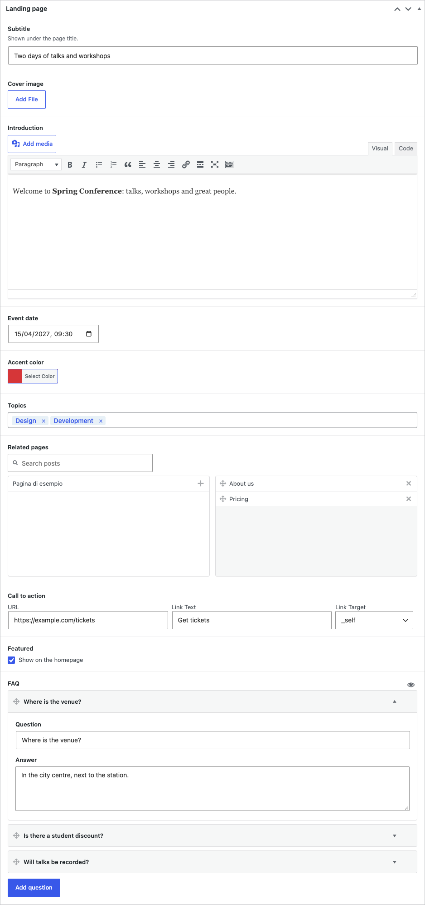
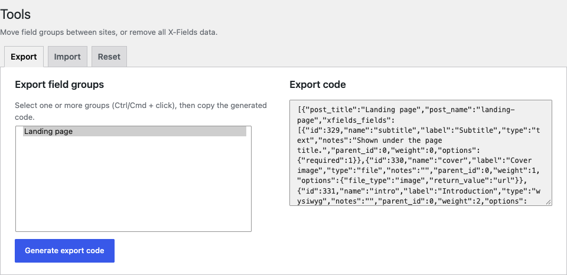

# X-Fields

Simple, secure custom fields for WordPress: field groups, placement rules, repeaters, relationships and front-end forms.

[](https://github.com/giaesp/x-fields/actions/workflows/ci.yml) [](https://github.com/giaesp/x-fields/releases/latest)   

X-Fields is a fork of [Custom Field Suite](https://github.com/mgibbs189/custom-field-suite) by Matt Gibbs, security-hardened, made PHP 8 compatible and redesigned. Maintained by [Gianluca Esposito](https://github.com/giaesp).



## Requirements

- WordPress 6.2+ (tested up to 7.1)
- PHP 7.4+ (tested up to 8.4)

## Installation

Install from the [WordPress.org plugin directory](https://wordpress.org/plugins/x-fields/) (once approved), or download the latest zip from [Releases](https://github.com/giaesp/x-fields/releases) and install it from **Plugins → Add New → Upload**, or clone into `wp-content/plugins/x-fields`.

If Custom Field Suite is installed, deactivate it first: X-Fields imports its field groups and values automatically on activation (the CFS tables are kept as a backup).

## Usage

1. **Settings → X-Fields → Add New**: create a field group and add fields.
2. In **Placement Rules** choose where it appears (post types, templates, terms, roles…).
3. Read values in your theme:

```php
// Single value (always escape output)
echo esc_html( XFields()->get( 'subtitle' ) );

// Another post
$cta = XFields()->get( 'cta', $post_id );

// All fields of the current post
$fields = XFields()->get();

// Repeater (Loop)
foreach ( (array) XFields()->get( 'faq' ) as $row ) {
    printf( '<h3>%s</h3>%s', esc_html( $row['question'] ), wp_kses_post( $row['answer'] ) );
}

// Posts that reference this post through a Relationship field
$ids = XFields()->get_reverse_related( get_the_ID(), [ 'field_name' => 'related', 'post_type' => 'page' ] );
```

### Saving from code

```php
XFields()->save( [ 'subtitle' => 'Hello' ], [ 'ID' => $post_id ] );
```

### Front-end form

```php
echo XFields()->form( [
    'post_id'              => false,       // false = create a new post
    'field_groups'         => [ 123 ],     // required for new posts
    'post_title'           => 'Title',     // label, or false to hide
    'post_status'          => 'pending',
    'post_type'            => 'post',
    'confirmation_url'     => home_url( '/thanks/' ),
    'submit_label'         => 'Send',
] );
```

Values submitted by users without the `unfiltered_html` capability are filtered with KSES, and shortcodes from anonymous visitors are neutralized. After submit, visitors are redirected only within the site: to use an external `confirmation_url`, whitelist its host with the `allowed_redirect_hosts` filter.

### Validation

Required fields and min/max limits are checked in the browser **and on the server**. Front-end forms reject invalid submissions; in the admin the post is saved and a notice lists the problems. Add your own rules:

```php
add_filter( 'xfields_validate_input', function( $errors, $field_data, $group_ids ) {
    // $field_data is keyed by field ID: [ 12 => [ 'value' => '...' ] ]
    return $errors;
}, 10, 3 );
```

### Permissions

Managing field groups and tools requires `manage_options`. Change it with:

```php
add_filter( 'xfields_manage_capability', fn() => 'edit_theme_options' );
```

### Field types

| Type | Notes |
|---|---|
| Text, Textarea | Textarea can convert newlines to `<br>` |
| WYSIWYG | Official WordPress editor (`wp.editor`): Visual/Code tabs, Add Media |
| Date | Native date or date-time picker; stored as `YYYY-MM-DD` / `YYYY-MM-DD HH:MM` |
| Color | WordPress color picker; stored as hex |
| True / False | Checkbox, returns `1` / `0` |
| Select | Single or multiple; optional search box (Tom Select) |
| File | Media library; returns URL or attachment ID |
| Relationship, Term, User | Two-column picker with search and drag & drop ordering |
| Loop | Repeater; can be nested; dynamic row labels (`{field_name:Fallback}`) |
| Hyperlink | URL + text + target; returns HTML or an array |
| Tab | Groups fields into tabs |

### Bundled libraries

Only one third-party library is bundled — everything else comes from WordPress core:

| Purpose | Library |
|---|---|
| Searchable selects | [Tom Select](https://github.com/orchidjs/tom-select) 2.6.2 (Apache-2.0), sources in `assets/vendor/tom-select/` |
| WYSIWYG | WordPress `wp.editor` (TinyMCE + Quicktags) |
| Color picker | WordPress `wp-color-picker` (Iris) |
| Date / time | Native browser inputs |
| Media, sorting | WordPress `wp.media`, jQuery UI Sortable |

### Hooks (selection)

| Hook | Type | Purpose |
|---|---|---|
| `xfields_field_types` | filter | Register custom field types |
| `xfields_matching_groups` | filter | Override which groups apply to a post |
| `xfields_pre_save_input` / `xfields_after_save_input` | action | Before/after a form save |
| `xfields_pre_render_fields` | filter | Alter fields before rendering |
| `xfields_validate_input` | filter | Add server-side validation errors |
| `xfields_manage_capability` | filter | Capability to manage field groups (default `manage_options`) |
| `xfields_field_relationship_query_args` | filter | Customise the Relationship post query |
| `xfields_relationship_display` / `xfields_term_display` / `xfields_user_display` | filter | Item label in pickers (receives escaped text) |

## Upgrading from 1.x

Version 2.0 uses longer, WordPress.org-compliant prefixes:

| 1.x | 2.x |
|---|---|
| `XF()` | `XFields()` |
| `xf_*` hooks / options | `xfields_*` |
| `XF_*` constants | `XFIELDS_*` (e.g. `XFIELDS_REMOVE_ALL_DATA`) |
| post type `xf_group` | `xfields_group` |

Data is migrated automatically on update (tables, field groups, values, options). Update the calls in your theme, e.g. `XF()->get( 'subtitle' )` → `XFields()->get( 'subtitle' )`.

## Multilingual (Polylang)

- Field groups are configuration and are never translated.
- When you create a translation, X-Fields copies the source values so you only translate them.
- Strings in the admin are translatable (text domain `x-fields`, Italian included).

## Uninstall

Data is kept by default. To remove everything on uninstall add to `wp-config.php`:

```php
define( 'XFIELDS_REMOVE_ALL_DATA', true );
```

## Screenshots

| Field group editor | Placement rules |
|---|---|
|  |  |

| Fields on the edit screen | Tools |
|---|---|
|  |  |

## Development

```bash
composer install
composer lint        # PHP syntax (all PHP files)
composer phpcs       # WordPress security + PHP compatibility rules
wp eval-file tests/smoke-test.php      # functional & security tests (inside a WordPress install)
wp eval-file tests/migration-test.php  # 1.x → 2.x and Custom Field Suite migrations
wp plugin check x-fields               # official Plugin Check (with the plugin-check plugin)
```

Releases follow [Semantic Versioning](https://semver.org/); see [CHANGELOG.md](CHANGELOG.md).
To release: update the version in `x-fields.php` (header + `XFIELDS_VERSION`) and `readme.txt`, update the changelog and this README, then tag `vX.Y.Z`. GitHub Actions builds the zip and — once the `SVN_USERNAME` / `SVN_PASSWORD` secrets are set — publishes it to WordPress.org together with the assets in `.wordpress-org/`.

## Contributing

See [CONTRIBUTING.md](CONTRIBUTING.md). Issues and pull requests are welcome.

## Security

Please report vulnerabilities privately via GitHub Security Advisories, not public issues. See [SECURITY.md](SECURITY.md).

## License

GPL-2.0-or-later. Copyright © 2026 Gianluca Esposito; © 2011–2024 Matt Gibbs (Custom Field Suite).
